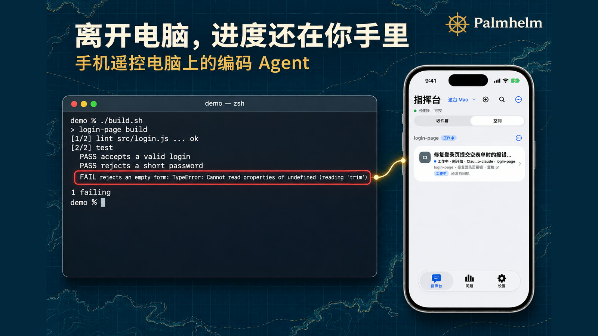

[English](#english) | [中文](#中文)

# Palmhelm

## English

Watch and steer the coding agents running in your terminal, from your iPhone and Mac.

Claude Code, Codex and other agents run in [Herdr](https://herdr.dev) panes. Palmhelm syncs their sessions to your phone and Mac, so you can read the conversation, queue messages, and handle approvals and questions.

### What it does

- **Session sync and reading**: read the agent's conversation on your phone and Mac. Only the user and assistant text shows; tool output and reasoning do not.
- **Queued messages with reasons**: drafts, waiting for idle, and queue position each explain why a message has not gone out yet.
- **Immediate insert**: slip a line into the current turn even while the agent is working.
- **Approvals and questions**: handle approvals and questions from your agents on your phone.
- **LAN and Tailscale direct**: connect straight to your Mac on the same network or over Tailscale.
- **Built-in Bridge on Mac**: lives in the menu bar and the notch; the app starts and stops the Bridge.

### Requirements

- macOS 15 or later, on a Mac with Apple silicon (M-series).
- [Herdr](https://herdr.dev) installed, with your agents (Claude Code, Codex, etc.) running in Herdr panes.

### Download

- Mac: [Palmhelm.dmg (latest)](https://github.com/forsakesoul/palmhelm/releases/latest/download/Palmhelm.dmg). Notarized by Apple.
- All releases and checksums: [GitHub Releases](https://github.com/forsakesoul/palmhelm/releases)
- iPhone: [Palmhelm on the US App Store](https://apps.apple.com/us/app/palmhelm/id6833474015) (free; not yet on the China mainland App Store)
- Download page: <https://forsakesoul.github.io/palmhelm/> (source in [`docs/`](docs/index.html))

This repository holds only the download page and release notes. The installers are on GitHub Releases.

### Privacy

Your data stays on your Mac. Session records, messages and approvals are stored in the local data directory. Conversations and data travel directly between your devices, with no Palmhelm server in between. The optional Feishu channel goes through Feishu, iPhone notifications go through Apple, and Tailscale may use its encrypted relay when it cannot connect directly. Full policy: [Privacy policy](docs/privacy.html).

### Changelog

[CHANGELOG.md](CHANGELOG.md)

---

## 中文

在 iPhone 和 Mac 上指挥终端里的编码 agent。

Claude Code、Codex 等 agent 跑在 [Herdr](https://herdr.dev) 窗格里。Palmhelm 把它们的会话同步到手机与 Mac，让你阅读对话、排队发消息、处理审批与提问。

### 能做什么

- **会话同步与对话阅读**：在手机与 Mac 上查看 agent 的对话。只显示用户与助手的正文，工具输出与思考不出现在这里。
- **消息排队与原因说明**：草稿、等待空闲、排位各有说明，知道消息为什么还没发出。
- **立即插入**：agent 正在工作时，也能把一句话插进当前回合。
- **审批与提问**：在手机上处理 agent 的审批与提问。
- **局域网与 Tailscale 直连**：同一局域网或经 Tailscale 直连 Mac。
- **Mac 内置 Bridge**：菜单栏与刘海常驻，Bridge 由 App 启动与停止。

### 系统要求

- macOS 15 或更高版本，Apple 芯片（M 系列）的 Mac。
- 已安装 [Herdr](https://herdr.dev)，并在 Herdr 窗格中运行 Claude Code、Codex 等 agent。

### 下载

- Mac 版：[Palmhelm.dmg（最新版）](https://github.com/forsakesoul/palmhelm/releases/latest/download/Palmhelm.dmg)，已通过 Apple 公证。
- 全部版本与校验值：[GitHub Releases](https://github.com/forsakesoul/palmhelm/releases)
- iPhone 版：[美区 App Store 上的 Palmhelm](https://apps.apple.com/us/app/palmhelm/id6833474015)（免费；国区暂未上架）
- 下载页：<https://forsakesoul.github.io/palmhelm/>（源码在 [`docs/`](docs/index.html)）

本仓库只放下载页与发行包的说明，安装包发布在 GitHub Releases。

### 隐私

数据留在你的 Mac。会话记录、消息与审批都保存在本机数据目录。对话与数据在你的设备之间直接传输，没有 Palmhelm 自己的服务器。可选的飞书通道经飞书传输，iPhone 通知经 Apple 送达；Tailscale 无法直连时，会经其加密中继。完整政策见 [隐私政策](docs/privacy.html)。

### 更新记录

[CHANGELOG.zh-CN.md](CHANGELOG.zh-CN.md)
