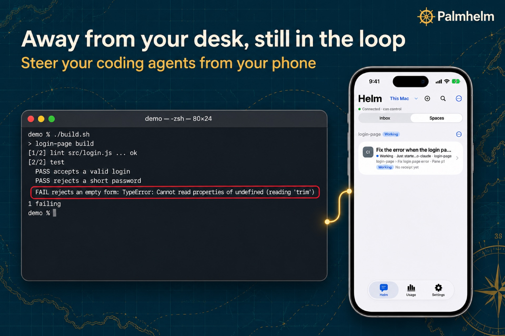

English | [中文](README.zh-CN.md)

# Palmhelm

## English

Watch and steer the coding agents running in your terminal, from your iPhone and Mac.

Claude Code, Codex and other agents run in [Herdr](https://herdr.dev) panes. Palmhelm syncs their sessions to your phone and Mac, so you can read the conversation, queue messages, and handle approvals and questions.

### What it does

- **Session sync and reading**: read the agent's conversation on your phone and Mac. Only the user and assistant text shows; tool output and reasoning do not.
- **Queued messages with reasons**: drafts, waiting for idle, and queue position each explain why a message has not gone out yet.
- **Immediate insert**: slip a line into the current turn even while the agent is working.
- **Approvals and questions**: handle approvals and questions from your agents on your phone.
- **LAN and Tailscale direct**: connect straight to your Mac on the same network or over Tailscale.
- **Built-in Bridge on Mac**: lives in the menu bar and the notch; the app starts and stops the Bridge.

### Requirements

- macOS 15 or later, on a Mac with Apple silicon (M-series).
- [Herdr](https://herdr.dev) installed, with your agents (Claude Code, Codex, etc.) running in Herdr panes.

### Download

- Mac: [Palmhelm.dmg (latest)](https://github.com/forsakesoul/palmhelm/releases/latest/download/Palmhelm.dmg). Notarized by Apple.
- All releases and checksums: [GitHub Releases](https://github.com/forsakesoul/palmhelm/releases)
- Command-line users: Palmhelm Bridge also runs on its own, without the Mac app (Apple silicon and Intel). See [bridge-0.3.17](https://github.com/forsakesoul/palmhelm/releases/tag/bridge-0.3.17). The Mac app remains the recommended way.
- iPhone: [Palmhelm on the US App Store](https://apps.apple.com/us/app/palmhelm/id6833474015) (free; not yet on the China mainland App Store)
- Download page: <https://forsakesoul.github.io/palmhelm/> (source in [`docs/`](docs/index.html))

This repository holds the download page, release notes, the privacy policy, and the MIT-licensed coding agent handoff skill in `skills/coding-agent-handoff`. The installers are on GitHub Releases.

### Skills

Coding agent handoff: a free, MIT-licensed skill that has your agent write a handoff before you leave, separating what was verified from what was not. Source: [`skills/coding-agent-handoff/`](skills/coding-agent-handoff/). Page: <https://forsakesoul.github.io/palmhelm/handoff.html>

Only the files under skills/coding-agent-handoff are open source, under the MIT license in that folder. Everything else in this repository is not covered by it.

### Privacy

Your data stays on your Mac. Session records, messages and approvals are stored in the local data directory. Conversations and data travel directly between your devices, with no Palmhelm server in between. The optional Feishu channel goes through Feishu, iPhone notifications go through Apple, and Tailscale may use its encrypted relay when it cannot connect directly. Full policy: [Privacy policy](docs/privacy.html).

### Changelog

[CHANGELOG.md](CHANGELOG.md)
