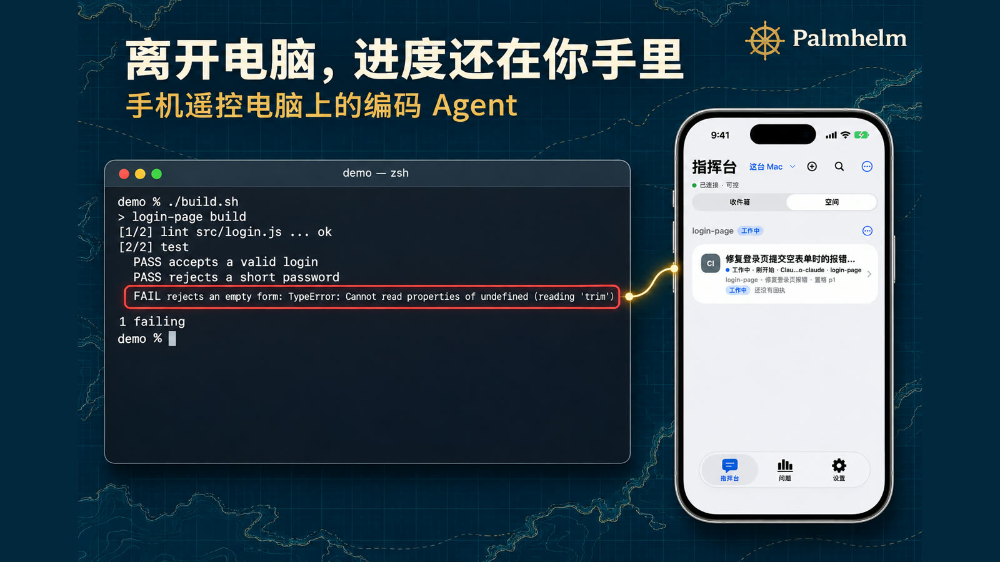

[English](README.md) | 中文

# Palmhelm

## 中文

在 iPhone 和 Mac 上指挥终端里的编码 agent。

Claude Code、Codex 等 agent 跑在 [Herdr](https://herdr.dev) 窗格里。Palmhelm 把它们的会话同步到手机与 Mac，让你阅读对话、排队发消息、处理审批与提问。

### 能做什么

- **会话同步与对话阅读**：在手机与 Mac 上查看 agent 的对话。只显示用户与助手的正文，工具输出与思考不出现在这里。
- **消息排队与原因说明**：草稿、等待空闲、排位各有说明，知道消息为什么还没发出。
- **立即插入**：agent 正在工作时，也能把一句话插进当前回合。
- **审批与提问**：在手机上处理 agent 的审批与提问。
- **局域网与 Tailscale 直连**：同一局域网或经 Tailscale 直连 Mac。
- **Mac 内置 Bridge**：菜单栏与刘海常驻，Bridge 由 App 启动与停止。

### 系统要求

- macOS 15 或更高版本，Apple 芯片（M 系列）的 Mac。
- 已安装 [Herdr](https://herdr.dev)，并在 Herdr 窗格中运行 Claude Code、Codex 等 agent。

### 下载

- Mac 版：[Palmhelm.dmg（最新版）](https://github.com/forsakesoul/palmhelm/releases/latest/download/Palmhelm.dmg)，已通过 Apple 公证。
- 全部版本与校验值：[GitHub Releases](https://github.com/forsakesoul/palmhelm/releases)
- 命令行用户：Palmhelm Bridge 也可以不装 Mac App 单独运行（Apple 芯片与 Intel），见 [bridge-0.3.17](https://github.com/forsakesoul/palmhelm/releases/tag/bridge-0.3.17)。推荐仍是 Mac App。
- iPhone 版：[美区 App Store 上的 Palmhelm](https://apps.apple.com/us/app/palmhelm/id6833474015)（免费；国区暂未上架）
- 下载页：<https://forsakesoul.github.io/palmhelm/>（源码在 [`docs/`](docs/index.html)）

本仓库放下载页、发行包说明、隐私政策，以及 MIT 许可的编码 agent 交接 skill（`skills/coding-agent-handoff`）。安装包发布在 GitHub Releases。

### 技能

编码 agent 交接 skill：免费、MIT 许可，让 agent 在你离开前写一份交接，区分已验证与未验证的内容。源码：[`skills/coding-agent-handoff/`](skills/coding-agent-handoff/)。文档页：<https://forsakesoul.github.io/palmhelm/handoff.html>

仅 skills/coding-agent-handoff 目录下的文件以该目录中的 MIT 许可开源，本仓库其余内容不适用。

### 隐私

数据留在你的 Mac。会话记录、消息与审批都保存在本机数据目录。对话与数据在你的设备之间直接传输，没有 Palmhelm 自己的服务器。可选的飞书通道经飞书传输，iPhone 通知经 Apple 送达；Tailscale 无法直连时，会经其加密中继。完整政策见 [隐私政策](docs/privacy.html)。

### 更新记录

[CHANGELOG.zh-CN.md](CHANGELOG.zh-CN.md)
